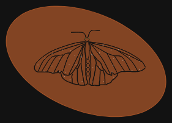

# monarchButterflyIcloud



A Go library that reads a public iCloud Shared Album: its name, its owner, and a download URL for every rendition of every photo and video.

Requires Go 1.25 or later. Imports only the standard library.

```sh
go get github.com/Smiduweorc/monarchButterflyIcloud
```

```go
c, err := monarchbutterflyicloud.NewClient(&http.Client{Timeout: 20 * time.Second})
if err != nil {
	log.Fatal(err)
}
// The token is the part of the share link after the '#'.
album, err := c.Album(ctx, "B0z5qAGN1JIFd3y")
if err != nil {
	log.Fatal(err)
}
for _, p := range album.Photos {
	for _, d := range p.Derivatives {
		fmt.Println(p.GUID, d.Height, d.URL)
	}
}
```

Not included:

- Downloading the files. Fetch `Derivative.URL` with your own client.
- Private albums, or anything that needs an Apple ID.
- Retries. A failed call returns its error; wrap `Album` if you want another attempt.
- Incremental sync. Every call fetches the whole album.

Known quirks:

- `NewClient` refuses a client without a `Timeout`, including `http.DefaultClient`, with `invalid_client`.
- The endpoints are the undocumented ones the icloud.com web viewer uses. If Apple changes them, `Album` fails with `unexpected_status` or `malformed_response`, or returns photos with fields left empty.
- One unparseable field fails the whole album with `malformed_response`, and the error names the photo and the field.
- A rendition that `/webasseturls` returns no URL for is left out of `Derivatives`.
- Untested against a live album so far. The test suite runs against a fake iCloud.
